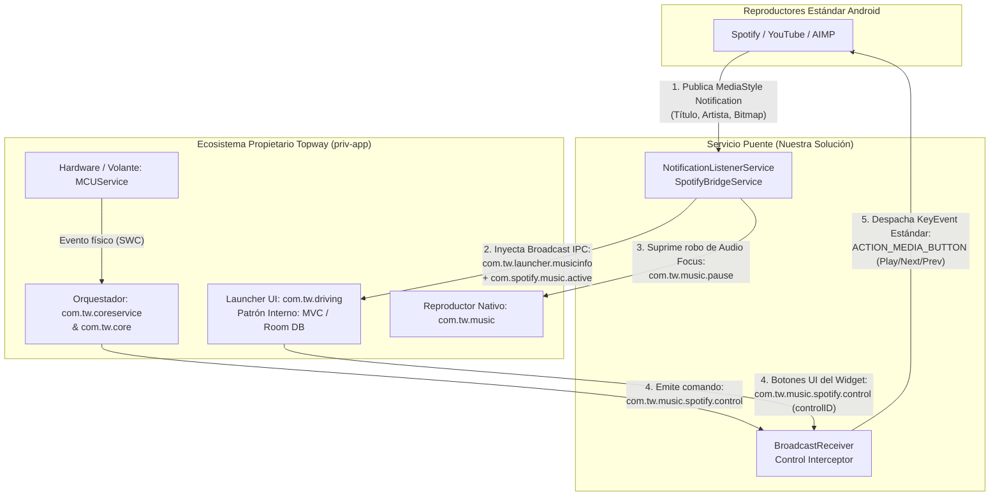

# 🚗 Topway Media Bridge (`SpotifyToTopway`)

Puente de comunicación inter-proceso (IPC) desarrollado en **Kotlin** para unidades principales automotrices Android basadas en la plataforma **Topway / Cardoor (`TS10` / `TS18` / `T3L`)**. 

Este servicio restaura y universaliza la integración nativa entre el widget multimedia del launcher original (**`com.tw.driving`**) y reproductores modernos de Android (**Spotify, YouTube, YouTube Music, AIMP**, etc.), solucionando la obsolescencia del servicio de fábrica `com.tw.spotify` (`TWSpotify.apk`) tras la deprecación del SDK `Spotify App Remote` y los cambios en políticas de notificaciones y foco de audio en Android.

---

## 🏗️ Análisis de Arquitectura del Ecosistema Topway

Mediante ingeniería inversa estática y análisis de paquetes del sistema (`priv-app`), se determinó que el firmware de Topway implementa una **Arquitectura Orientada a Mensajes y Eventos (Event-Driven / Message-Driven Architecture sobre Android Binder IPC)** para desacoplar la interfaz gráfica de conducción de los servicios de hardware (MCU/CAN Bus) y de los reproductores multimedia.

### 1. Vista Global de Componentes (IPC Bus)

### 2. Separación de Niveles Arquitectónicos
* **Nivel Macro (Inter-Proceso / Sistema): Arquitectura Orientada a Mensajes (Pub/Sub & Message Passing)**
  * **Publicación/Suscripción vía Broadcasts:** Los servicios emiten *Intents* explícitos e implícitos con contratos de datos estrictos (*Extras*) a través del bus del sistema operativo.
  * **Colas de Mensajes (`android.os.Messenger`):** Los paquetes base (`com.tw.core.messenger.server.MessengerService` y `com.tw.coreservice`) gestionan colas asíncronas sobre Binder para comunicar eventos del microcontrolador del vehículo (`MCUService`) hacia la capa de aplicación.
* **Nivel Micro (Intra-Proceso en `com.tw.driving`): MVC / MVVM**
  * **Modelo:** Persistencia local mediante **Jetpack Room / SQLite** (`MultiInstanceInvalidationService`) y objetos de estado de reproducción en memoria.
  * **Vista:** Actividades principales (`com.tw.driving.MainActivity`) y recursos gráficos del tablero protegidos en tiempo de ejecución mediante empaquetado **Qihoo 360 Jiagu** (`libjgdtc.so`).
  * **Controlador:** Receptores internos que validan los mensajes entrantes del tópico `com.tw.launcher.musicinfo` y actualizan el lienzo del widget.

---

## 🔍 Ingeniería Inversa del Protocolo Topway

Al analizar la tabla de símbolos y cadenas de `classes.dex` dentro del paquete original `com.tw.spotify` (`TWSpotify.apk`), se identificaron los contratos de datos exactos que espera el launcher `com.tw.driving`:

### A. Canal de Telemetría y Metadatos (Hacia el Launcher)
* **Acción de Activación:** `com.spotify.music.active`
  * Indica al orquestador de Topway que el canal de música externa se encuentra activo.
* **Acción de Datos:** `com.tw.launcher.musicinfo`
* **Contrato de Payload (`Bundle Extras`):**

| Clave (Extra) | Tipo de Dato | Descripción |
| :--- | :--- | :--- |
| `msg_Song` / `track` | `String` | Título de la pista en reproducción. |
| `msg_Artist` / `artist` | `String` | Nombre del artista o canal. |
| `album` | `String` | Nombre del álbum o texto secundario. |
| `msg_Albumart` | `ByteArray` | Carátula del álbum comprimida en formato JPEG (`150x150px`). |
| `playState` | `Int` | Estado numérico (`1` = Reproduciendo, `0` = Pausado). |
| `musicType` | `Int` | Identificador de fuente externa (`1`). |
| `package` | `String` | Nombre del paquete emisor (`com.spotify.music`). |

### B. Arbitraje de Foco de Audio (Prevención de colisión con `com.tw.music`)
Cuando el launcher detecta actividad multimedia sin haber silenciado explícitamente al reproductor local de fábrica (`com.tw.music` / `com.ts.music`), el sistema nativo intenta recuperar el foco de audio y fuerza la reproducción de archivos MP3 locales. 
Para neutralizar este comportamiento, el puente emite de forma preventiva:
* `com.tw.music.pause`
* `com.ts.music.pause`

### C. Canal de Control Multimedia (Desde el Launcher/Volante hacia el Reproductor)
Cuando el usuario presiona los controles en el widget de `Driving` o en el volante del vehículo, el launcher emite un broadcast con la acción:
* **Acción:** `com.tw.music.spotify.control`
* **Parámetro:** `controlID` (`Int` / `String`)
  * `1` -> Play / Resume
  * `2` -> Pause
  * `3` -> Pista Anterior (`KEYCODE_MEDIA_PREVIOUS`)
  * `4` / `0` -> Pista Siguiente (`KEYCODE_MEDIA_NEXT`)

Nuestro servicio intercepta esta acción propietaria y la traduce en eventos estándar de Android (`Intent.ACTION_MEDIA_BUTTON` con `KeyEvent`), permitiendo controlar no solo Spotify, sino cualquier reproductor activo en el sistema (YouTube, YouTube Music, AIMP).

---

## 🛠️ Compilación e Instalación

### Compilación automatizada (CI/CD)
El proyecto cuenta con un flujo de integración continua mediante **GitHub Actions** (`.github/workflows/android.yml`) que compila el APK de depuración en cada `push` utilizando JDK 17 y Gradle.

### Configuración en la Unidad Topway
1. Instalar el paquete `app-debug.apk` generado.
2. Abrir **SpotifyBridge** y tocar el botón **"1. Activar Permiso de Notificaciones"**.
3. Habilitar el interruptor para **SpotifyBridge** en la lista del sistema (`NotificationListenerService`).
4. Iniciar la reproducción en Spotify, YouTube o AIMP y regresar al launcher principal (`Driving`).

---

## 💻 Tecnologías Utilizadas
* **Lenguaje:** Kotlin (Android SDK 34)
* **Componentes Android:** `NotificationListenerService`, `BroadcastReceiver`, `KeyEvent`, `Handler/Looper`, `Bitmap/ByteArrayOutputStream`.
* **CI/CD:** GitHub Actions.
* **Ingeniería Inversa & Diagnóstico:** Análisis de `classes.dex`, inspección de procesos `priv-app` y monitoreo de IPC Broadcasts.
